<p align="center">
  <picture>
    <source media="(prefers-color-scheme: dark)" srcset="assets/radar-dark.svg">
    <source media="(prefers-color-scheme: light)" srcset="assets/radar-light.svg">
    
  </picture>
</p>

<h3 align="center">Attackers don’t start with your code.<br>They start with what’s public about you.</h3>

<p align="center">
  <b>Ankur Khunt</b> · Developer turned Security Engineer · Gujarat, India<br>
  <a href="https://shift-left-kit.pages.dev"><b>🌐 shift-left-kit.pages.dev</b></a> ·
  <a href="https://www.linkedin.com/in/ankur-khunt-122b971b0">LinkedIn</a> ·
  <a href="mailto:ankurldce2023@gmail.com">Email</a>
</p>

---

### `$ whoami`

I spent my first years building features. Now I look at them the way an attacker would - and show developers how to do the same.

In August 2024 a senior on my team asked if I was interested in security. I said yes -
**not really knowing what I was saying yes to.**

### `$ cat focus.txt`

```text
build    Full-stack developer first: Angular, React, .NET, gRPC, Docker
break    Web app pentesting: SQLi, XSS, CSRF, RCE, LFI, CORS, cache poisoning
bridge   Turning findings into fixes - and shortcuts developers can run themselves
```

- 🔍 **Attack surface & OSINT** - how attackers map you from public data before sending a single request
- 🧪 **OWASP Top 10 (2025), from the outside in** - why each bug happens, how it’s found, how to fix it
- 🛠️ **Recon for developers** - one-liners and scripts to map your *own* domain

### `$ ls ~/projects`

| project | what | status |
|---|---|---|
| **[shift-left-kit.pages.dev](https://shift-left-kit.pages.dev)** | Attack surface, OSINT and OWASP Top 10 explained for developers - with a [self-recon checklist](https://shift-left-kit.pages.dev/osint/self-recon/) and an [attack surface lookup](https://shift-left-kit.pages.dev/osint/lookup/) | ✅ live |
| **[recon.sh](https://shift-left-kit.pages.dev/osint/automate/)** | Maps your own domain’s attack surface (subdomains, DNS & email, archives, exposed files, headers) into a local HTML report | ✅ [download](https://shift-left-kit.pages.dev/osint/automate/) |

### `$ cat certs.txt`

```text
[done]         CC - Certified in Cybersecurity, (ISC)²
[in progress]  eJPT - Junior Penetration Tester
[in progress]  OSCP - Offensive Security Certified Professional
```

### `$ ls ~/toolbox`

`Burp Suite` `OWASP ZAP` `Nmap` `Nuclei` `sqlmap` `Nessus` `Maltego` `TruffleHog` `SysReptor`
`TypeScript` `C#` `Python` `React` `Angular` `.NET` `Node.js` `Docker` `PostgreSQL` `gRPC`

---

<sub>The radar banner is an animated SVG generated by <a href="scripts/make_radar.py"><code>scripts/make_radar.py</code></a> - pure CSS, no JavaScript. Only test systems you own or are authorized to test.</sub>
